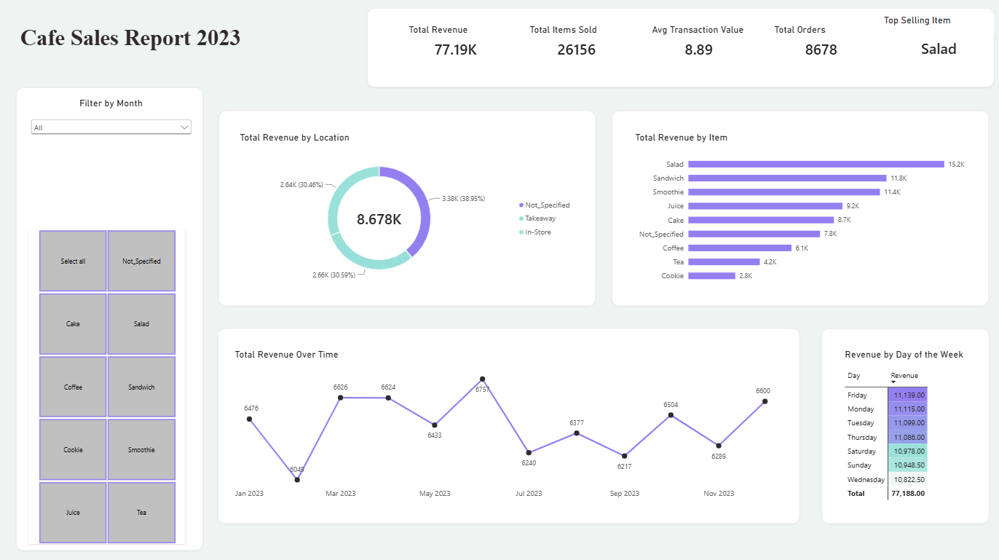
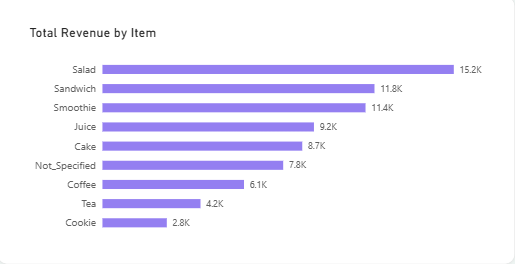
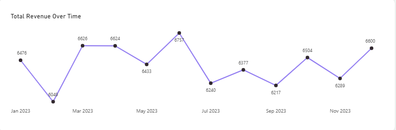
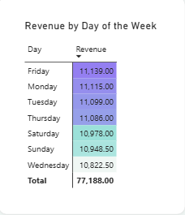
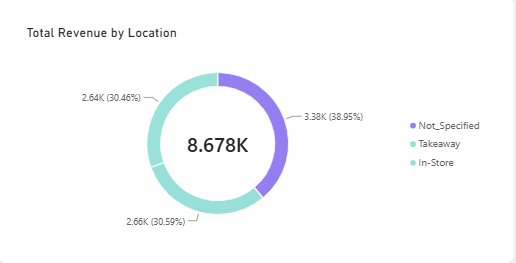

# Retail Cafe Sales & Operations Analysis

## Overview
This project is an end-to-end business intelligence and data analytics dashboard built to evaluate sales performance, item popularity, and operational patterns for a retail cafe. 

The primary objective is to transform raw, unstructured transaction records into a polished, executive-level interactive dashboard using an "inverted pyramid" layout. The technical pipeline integrates **Python (Pandas)** for initial data processing, **Power Query** for automated date transformations and modeling, and **Power BI Desktop** for visualization, leveraging custom **Microsoft Fabric** styling themes.

Ultimately, this project bridges data engineering cleanliness with clean UX design to uncover peak operational days, top menu revenue drivers, and valuable data quality insights regarding unassigned order channels.

---

## Executive Dashboard
To view the interactive visualizations, filtering capabilities, and dynamic metrics, access the project report file located in the dashboards directory.

**📁 [View Power BI Dashboard File](/04_dashboards/cafe_sales_dashboard.pbix)**

---

## Business Questions
1. **Item Performance:** 
   * Which menu items are driving the majority of our revenue and customer volume?
2. **Temporal Trends & Operations:** 
   * Which days of the week and months experience peak customer activity to guide inventory and staffing?
3. **Channel Breakdown & Data Quality:** 
   * How are sales distributed across order locations, and how can we address operational tracking gaps (e.g., "Not_Specified")?

---

## Analysis Approach

### 1. Item Performance & Top-Sellers
- Analyzed transaction line items to rank products by total revenue contribution and sales volume.
- Utilized dynamic DAX measures and visual filters to instantly search and highlight key metrics like the top-selling item.

    *Script/Transform Reference:* [clean.py](/03_src/clean.py)

**Key Findings**
- **The Top Driver:** Items like *Salad* and *Sandwich* dominate the revenue leaderboard, bringing in the highest individual product returns (~15.2K and ~11.8K respectively).
- **The Core Product Mix:** A reliable middle tier of beverages and baked goods forms the consistent transactional backbone of daily operations.

**Visualization**

**Business Insights**
- Menu optimization should protect and heavily promote top-performing items while reviewing low-margin or slow-moving items at the bottom of the stack.
- Cross-selling initiatives can pair top-tier food items (Salads/Sandwiches) with steady beverage drivers to maximize average transaction value.

---

### 2. Temporal & Operational Trends
- Extracted granular temporal fields (`Sales Day`, `Day Name`, `Day Number`) via Power Query.
- Built a chronological sorting system using hidden helper columns to ensure weekly charts display seamlessly from Monday to Sunday.

    *Transform Reference:* Power Query Applied Steps / `clean.py`

**Key Findings**
- **Weekday Demand Plateaus:** The matrix table reveals steady mid-week revenue spikes (particularly Tuesdays through Thursdays), outperforming standard weekend performance patterns.
- **Monthly Volatility:** The revenue-over-time line chart highlights seasonal fluctuations and dip periods throughout the operational year, providing historical context for revenue planning.

**Visualizations**

**Business Insights**
- Management should adjust staff scheduling and ingredient prep schedules to heavily align with the mid-week volume peaks shown in the heatmap.
- Marketing promotions can be deployed during historical monthly sales dips to smooth out revenue volatility.

---

### 3. Channel Breakdown & Data Quality
- Segmented transaction channels into In-Store and Takeaway using distribution metrics.
- Preserved unassigned records (`Not_Specified`) rather than dropping them to maintain financial reconciliation accuracy.

**Key Findings**
- **Tracking Gaps:** A notable percentage of orders fall under the `Not_Specified` location category, signaling operational data capture bottlenecks at the point-of-sale terminal during high-traffic hours.
- **Channel Distribution:** Valid recorded orders show a healthy split between in-store dining and takeaway convenience.

**Visualization**

**Business Insights**
- Rather than deleting missing data (which would artificially deflate revenue totals), treat `Not_Specified` as an operational KPI to train staff on proper POS terminal logging.
- Improving data capture compliance will yield cleaner location-based analytics for future expansions.

---

## Strategic Recommendations

1. **Align Staffing and Inventory with Day-of-Week Matrix Peaks**
   * Use the chronological day-of-week matrix to dynamically adjust labor hours and fresh inventory prep, ensuring peak mid-week rush hours are fully supported without over-allocating resources on slower days.
2. **Standardize POS Terminal Logging to Eliminate "Not_Specified" Gaps**
   * Address the root cause of unassigned transaction records by introducing mandatory field prompts at checkout, turning a data hygiene issue into accurate operational intelligence.
3. **Leverage Top-Selling Items for Bundled Promotions**
   * Feature proven high-revenue drivers like *Salad* and *Sandwich* in targeted meal-deal bundles to lift the average transaction value across secondary beverage categories.

## Technical Details
- **Development Environment:** Visual Studio Code (VS Code) for Python scripting, notebook prototyping, and project architecture management.
- **Data Engineering & Cleaning:** Python (`pandas`), Power Query (M code)
- **Data Modeling & Calculations:** DAX (Data Analysis Expressions)
- **Visualization & Design:** Power BI Desktop (`.pbix`), Microsoft Fabric Design Themes, UX-driven "Inverted Pyramid" layout
- **Project Architecture:** Modular directory structure (`01_data`, `02_notebooks`, `03_src`, `04_dashboards`)